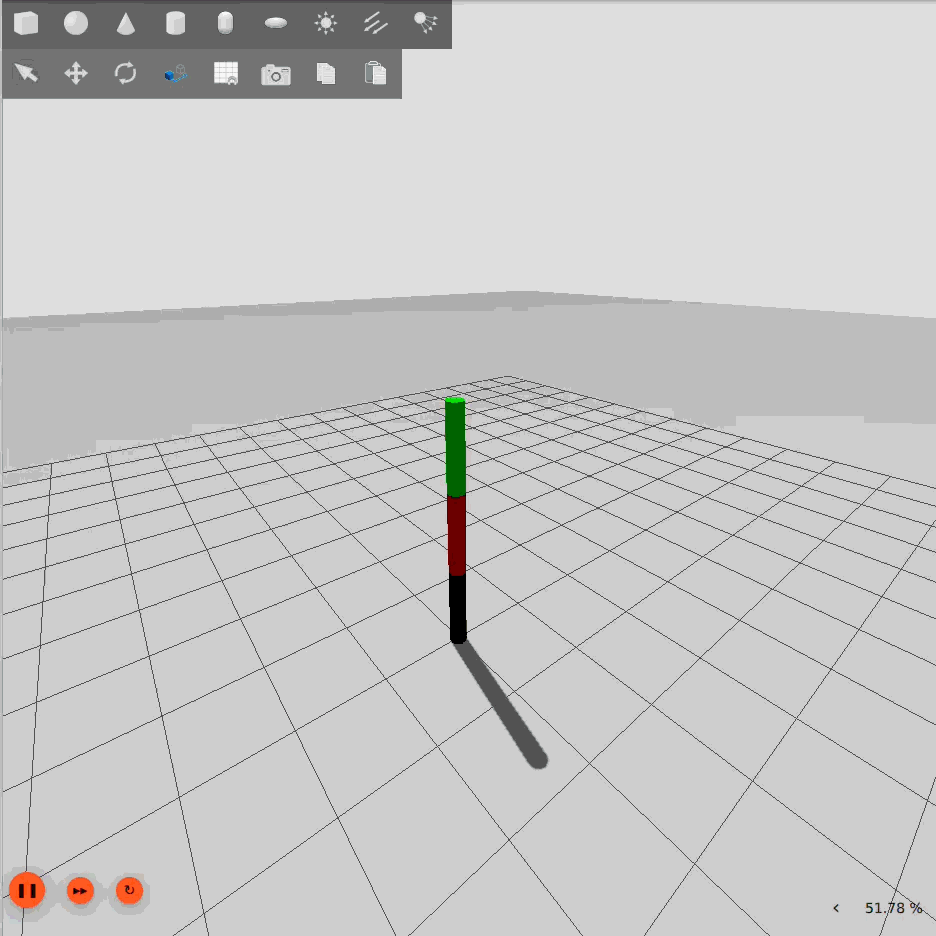
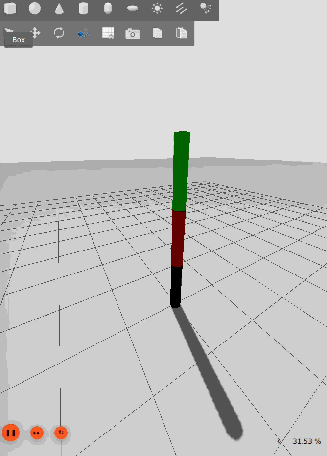

# Motion planning and Optimal Feedback Controller (TV-LQI + UKF) for Robotic Arm


## Demonstration from (0.0, 0.0, 0.0) to (2.0, 2.0, -2.0) to (1.0, 1.0, 1.0)
<p align="center">
  
</p>


## Overview
This repository contains an **ROS 2 package** of an **Optimal Feedback Controller** designed for robotic manipulators. The core algorithm is based on a **Time-Varying Linear Quadratic Integrator (TV-LQI)** for trajectory tracking, coupled with an **Unscented Kalman Filter (UKF)** for state estimation. It also contains a baselin **Computed Torque Controller (CTC)**.

## Key Features
- **Path computation**: Through an **Rapidly-exploring Random Tree (RRT) algorithm** smoothed using the **Artificial Potential Field (APF)** framework.
- **Initial trajectory creation**: The desired trajectory is computed through a **polynomial trajectory planning**.
- **Trajectory Tracking**: **TV-LQI** solves the finite-horizon Riccati equation backward in time to generate optimal tracking gains.
- **Smooth Hold Mode**: Automatically switches from transient TV-LQI gains to a stable infinite-horizon LQI gain combined with Inverse Dynamics gravity compensation once the trajectory is completed.
- **Robust state estimation**: UKF is use to overcome noisy measurements and predict the full state accurately without requiring analytical derivatives.
- **CTC Controller**

## Dependencies

- **OS:** Ubuntu 24.04 LTS (Native or via **WSL2** on Windows 11/10)
- **Middleware:** ROS 2 (Jazzy)
- **Language:** C++17 (or higher)
- **Math Library:** [Eigen3](https://eigen.tuxfamily.org/)
- **Build System:** `colcon` and `ament_cmake`

* Code tested under Windows subsystem for Linux (WSL).


## Build & run instructions
This package is build for **ROS 2** (Jazzy)
Create the workspace and copy the package
```bash
mkdir -p ~/ros2_ws/src
cd ~/ros2_ws/src
git clone https://github.com/rebonatoaurelien-create/ros2_optimal_control_arm.git
cd ~/ros2_ws
colcon build --symlink-install --cmake-args -DCMAKE_BUILD_TYPE=Release
source install/setup.bash
```
Launch simulation
```
ros2 launch robot_arm_pkg gazebo.launch.py
```
Publish goal
```
ros2 topic pub --once /goal std_msgs/msg/Float64MultiArray "{data: [1.0, 1+.0, 1.0]}"
```
Change desired controller
```
ros2 param set /controller_node use_tvlqr false
```
Introduce Gaussian Noise
```
ros2 param set /controller_node with_noise true
```

## Control Architecture

Below are the theorical foundations:

### 1. Motion Planning: RRT + APT & polynomials
To generate the path between the initial configuration and the desired configuration:
- **Global Pathfinding**: Implements a RRT combined with Apf to find a path in the C-space. The RRT has been implemented according to the pseudo code of Lynch & Park (*Modern Robotics*, 2017).
- **Smoothing & parametrization**: The raw waypoints are interpolated using 5th-order polynomials to ensure continuity.

### 2. State Estimation: UKF
As sensors provide noisy partial measurements, we used an UKF for optimal sensor estimation. This project firstly used an Extended Kalman Filter which diverged quickly, probably due to the linearization of the robot dynamics. The propagation of an set of sigma point through the non-linear RK4 step captures the mean and the covariance accurately.

### 3. Optimal tracking: TV-LQI
- **TV-LQI formulation**: Solves the continuous-time finite-horizon Riccati differential equation to find the optimal gain that minimize the energy-error cost function.
- **Integral Action (LQI)**: An augmented state incorporated the integral of the position error.

### 4. Basic CTC controller
- Use feedaback linearization to cancel the robot's non-linear dynamics (inertia, Coriolis, and gravity) and impose a linear error dynamics using a PD law.

## Results

Results using the CTC controller
<p align="center">
  
</p>